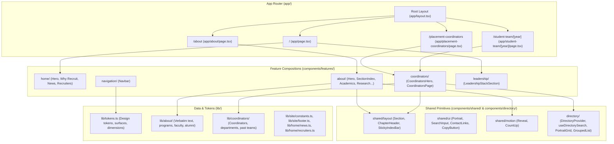

# IIT Kanpur SPO Website — Codebase Architecture & File Organization Guide

This document is a comprehensive map of the entire codebase (`spo-website-new`). It explains the architectural layers, how each route is composed, where data lives, how components communicate, and the subtle quirks ("the mess") you need to know before reading and editing the code.

---

## 1. High-Level Architecture & Tech Stack



### Core Technologies
- **Framework**: Next.js 16 (Turbopack, App Router, React 19).
- **Styling**: Tailwind CSS 3.4 with custom `@tailwindcss/typography`, container queries, and CSS variables.
- **Animation**: Framer Motion 12 (`motion`, `AnimatePresence`, `useScroll`, `useTransform`, `useReducedMotion`).
- **Smooth Scroll**: Lenis (`@studio-freight/lenis` via custom `SmoothScroll.tsx`).
- **Icons**: Tabler Icons (`@tabler/icons-react`).
- **Accessible Headless UI**: `@base-ui-components/react` (used by `NavigationMenu`).
- **Typography**: Inter Tight (`--font-inter-tight`) and Geist Mono (`--font-geist-mono`).

---

## 2. Directory Layout & Layer Boundaries

The project strictly follows a four-tier architecture:

```
spo-website-new/
├── app/                  # Next.js App Router (pages, layout, metadata)
├── components/
│   ├── ui/               # Global Design System primitives & widgets
│   ├── shared/           # Generic page-agnostic building blocks (layout, motion, UI)
│   ├── directory/        # Reusable people/directory system (grid, search, filtering)
│   └── features/         # Page-specific composite sections (home, about, coordinators)
├── lib/                  # Pure TypeScript data, tokens, utilities, helpers
├── public/               # Static assets (images, logos, videos, brochures)
└── docs/                 # Architectural rules and documentation
```

### The Strict Boundary Rule
> [!IMPORTANT]
> - `components/shared/` and `components/directory/` **never import** from `components/features/` or `lib/{feature}/`. They accept data strictly via props or generic contexts.
> - Feature components (`components/features/`) consume data from `lib/` and compose primitives from `components/shared/`, `components/directory/`, and `components/ui/`.

---

## 3. Global Shell (`app/layout.tsx` & `app/globals.css`)

### 1. `app/layout.tsx`
- **Mount Point**: Root HTML wrapper for every page.
- **Global Providers**:
  - `SmoothScroll` ([`components/ui/SmoothScroll.tsx`](file:///home/ujjwal/Desktop/02%20Work%20&%20PORs/Spo%20Website/spo-website-new/components/ui/SmoothScroll.tsx)): Initializes the Lenis smooth-scrolling engine on the window.
  - `SiteFooter` ([`components/ui/SiteFooter.tsx`](file:///home/ujjwal/Desktop/02%20Work%20&%20PORs/Spo%20Website/spo-website-new/components/ui/SiteFooter.tsx)): The persistent dark editorial footer rendered at the bottom of *all* routes. Data is fetched from [`lib/site/footer.ts`](file:///home/ujjwal/Desktop/02%20Work%20&%20PORs/Spo%20Website/spo-website-new/lib/site/footer.ts).
- **Fonts**: Injects `interTight` and `geistMono` CSS variables onto `<html>`.
- **Default Theme**: Body is locked to `bg-[#06080d] text-white antialiased font-sans`.

### 2. `app/globals.css`
- Configures Tailwind base directives.
- Defines font variables (`--font-inter-tight`, `--font-geist-mono`).
- Custom scrollbar styling (`no-scrollbar` utility for horizontal scrolling tabs).
- Lenis required CSS rules (`html.lenis, html.lenis body { height: auto; }`).

---

## 4. Page-by-Page Composition

### Route 1: Homepage (`/` — [`app/page.tsx`](file:///home/ujjwal/Desktop/02%20Work%20&%20PORs/Spo%20Website/spo-website-new/app/page.tsx))

A vertical editorial storytelling scroll composed of 4 key sections:

```
[ app/page.tsx ]
   ├── <HomeScrollConfig />            # Tweaks smooth scroll parameters
   ├── <HeroSection />                 # Fullscreen video shrink & floating nav
   ├── <WhyRecruitHorizontalScroll />  # Pinned horizontal sliding panels
   ├── <LeadershipStackSection />      # Sticky stacked cards (Director & Chairs)
   └── <NewsAndRecruiters />           # Announcement list + Recruiter logos
```

1. **`<HeroSection />`** ([`components/features/home/HeroSection.tsx`](file:///home/ujjwal/Desktop/02%20Work%20&%20PORs/Spo%20Website/spo-website-new/components/features/home/HeroSection.tsx))
   - Uses `ScrollShrink` ([`components/ui/ScrollShrink.tsx`](file:///home/ujjwal/Desktop/02%20Work%20&%20PORs/Spo%20Website/spo-website-new/components/ui/ScrollShrink.tsx)) to animate the background video from 100vw/100vh down to a floating rounded card as the user scrolls.
   - Contains:
     - `<Navbar tone="dark" />` (floating variant).
     - `<HeroContent />` ([`components/features/home/HeroContent.tsx`](file:///home/ujjwal/Desktop/02%20Work%20&%20PORs/Spo%20Website/spo-website-new/components/features/home/HeroContent.tsx)): Main typographic statement and CTA buttons.
     - `<HeroStats />` ([`components/features/home/HeroStats.tsx`](file:///home/ujjwal/Desktop/02%20Work%20&%20PORs/Spo%20Website/spo-website-new/components/features/home/HeroStats.tsx)): Live animated placement metrics.

2. **`<WhyRecruitHorizontalScroll />`** ([`components/features/why-recruit/WhyRecruitHorizontalScroll.tsx`](file:///home/ujjwal/Desktop/02%20Work%20&%20PORs/Spo%20Website/spo-website-new/components/features/why-recruit/WhyRecruitHorizontalScroll.tsx))
   - Pins the viewport using sticky positioning (`h-[400vh]` outer container) and transforms vertical scroll progress into horizontal translation (`transform: translateX(...)`).
   - Data comes from [`lib/home/why-recruit.ts`](file:///home/ujjwal/Desktop/02%20Work%20&%20PORs/Spo%20Website/spo-website-new/lib/home/why-recruit.ts).

3. **`<LeadershipStackSection />`** ([`components/features/leadership/LeadershipStackSection.tsx`](file:///home/ujjwal/Desktop/02%20Work%20&%20PORs/Spo%20Website/spo-website-new/components/features/leadership/LeadershipStackSection.tsx))
   - Sticky stacked cards displaying messages from the Director and Placement Chairperson.
   - Data comes from [`lib/home/leadership.ts`](file:///home/ujjwal/Desktop/02%20Work%20&%20PORs/Spo%20Website/spo-website-new/lib/home/leadership.ts).

4. **`<NewsAndRecruiters />`** ([`components/features/home/NewsAndRecruiters.tsx`](file:///home/ujjwal/Desktop/02%20Work%20&%20PORs/Spo%20Website/spo-website-new/components/features/home/NewsAndRecruiters.tsx))
   - Combines `<NewsSection />` (data from [`lib/home/news.ts`](file:///home/ujjwal/Desktop/02%20Work%20&%20PORs/Spo%20Website/spo-website-new/lib/home/news.ts)) and `<RecruiterMarquee />` (infinite ticker from [`lib/home/recruiters.ts`](file:///home/ujjwal/Desktop/02%20Work%20&%20PORs/Spo%20Website/spo-website-new/lib/home/recruiters.ts)).

---

### Route 2: About IITK (`/about` — [`app/about/page.tsx`](file:///home/ujjwal/Desktop/02%20Work%20&%20PORs/Spo%20Website/spo-website-new/app/about/page.tsx))

An editorial chapter-based page alternating between dark and light sections. All text is 100% data-driven and lives in `lib/about/`.

```
[ app/about/page.tsx ]
   ├── <AboutHero />              # Fixed bar navbar, big typography, animated facts strip
   ├── <SectionIndex />           # Sticky scrollspy subnav bar (#about, #academics...)
   ├── <IntroSection />           # 01. History, mission, stone entrance photo (Dark)
   ├── <AcademicsSection />       # 02. Academic programs accordion & degrees (Light)
   ├── <ResearchSection />        # 03. R&D centers, labs, patents (Dark)
   ├── <AlumniSection />          # 04. Notable alumni grid + show more toggle (Light)
   ├── <FacultySection />         # 05. Distinguished awards (Bhatnagar, Infosys) (Dark)
   └── <CampusLifeSection />      # 06. Student councils & festivals (Antaragni, Techkriti) (Light)
```

#### Key Components:
- **`AboutHero.tsx`**: Uses `<Navbar tone="dark" variant="bar" />`. Fixes content jump by applying `pt-16`. Includes `FactCounter` with count-up animations.
- **`SectionIndex.tsx`**: Sticky bar beneath the 56px navbar that highlights the active section as you scroll and allows smooth clicking to `#academics`, `#research`, etc.
- **Data files in `lib/about/`**:
  - `content.ts`: Main copy, section headers, quotes, and images.
  - `programmes.ts`: All degree programs (B.Tech, BS, M.Tech, MS, Ph.D, MBA, etc.).
  - `research.ts`: Centers of excellence and industrial research statistics.
  - `alumni.ts`: Notable alumni profiles (Narayana Murthy, Arvind Krishna, etc.).
  - `faculty.ts`: Faculty fellowship data.
  - `campus-life.ts`: Student Gymkhana councils, sports, and festival dates.
  - `facts.ts`: Top hero numerical counters.

---

### Route 3: Placement Coordinators (`/placement-coordinators` — [`app/placement-coordinators/page.tsx`](file:///home/ujjwal/Desktop/02%20Work%20&%20PORs/Spo%20Website/spo-website-new/app/placement-coordinators/page.tsx))

A high-performance directory page built on a reusable search and layout engine:

```
[ app/placement-coordinators/page.tsx ]
   ├── <CoordinatorsHero />         # Fixed bar navbar, headline, live coordinator counters
   └── <CoordinatorsPage />         # DirectoryProvider wrapper
         ├── <StickyIndexBar />     # Sticky chapter bar with embedded real-time SearchInput
         └── #directory-results
               ├── 01. Overall Coordinators       -> <PortraitGrid columns={4} />
               ├── 02. Assistant Coordinators     -> <PortraitGrid columns={4} />
               ├── 03. Department Coordinators    -> <GroupedList getGroup={dept} />
               ├── 04. Web Team Leads/Execs       -> <PortraitGrid columns={4} />
               └── 05. Previous Teams Index       -> <IndexList items={pastYears} />
```

#### How the Directory Search Engine Works:
- **`DirectoryProvider`** ([`components/directory/DirectoryProvider.tsx`](file:///home/ujjwal/Desktop/02%20Work%20&%20PORs/Spo%20Website/spo-website-new/components/directory/DirectoryProvider.tsx)):
  - Holds state: `query`, `setQuery`, `isSearching`, `resultCount`.
  - Injects `filterList<T>(list)`: filters any list in real-time by checking `getPersonSearchText(person)` (name, email, department, role).
  - When searching, any section with 0 results displays an inline `<EmptyResults />` indicator, or a global empty state if no coordinator matches.
- **Data files in `lib/coordinators/`**:
  - `overall.ts`: Overall placement coordinators (with photos, phone, email, LinkedIn).
  - `assistants.ts`: Assistant placement coordinators.
  - `departments.ts`: Department-wise coordinators (grouped automatically by `GroupedList`).
  - `web-team.ts`: Web team leads and executives.
  - `previous-teams.ts`: Archive links for teams from 2025-26 back to 2013-14.
  - `types.ts`: Interface `Person` and `getPersonSearchText()` search indexer.

---

### Route 4: Past Student Teams (`/student-team/[year]` — [`app/student-team/[year]/page.tsx`](file:///home/ujjwal/Desktop/02%20Work%20&%20PORs/Spo%20Website/spo-website-new/app/student-team/%5Byear%5D/page.tsx))

- **Static Generation**: Uses `generateStaticParams()` to pre-render pages for every year in `lib/coordinators/past-teams/all-past-teams.json`.
- Renders:
  - Back navigation link to `/placement-coordinators#previous-teams`.
  - Members with photos in `<PortraitGrid columns={4} />`.
  - Members without photos in a compact `<RowList />`.

---

## 5. Global Navigation System (`Navbar.tsx` & `NavigationMenu.tsx`)

The navigation bar was built to support two distinct modes via the `variant` prop:

```typescript
export interface NavbarProps {
  tone?: "light" | "dark";
  variant?: "default" | "bar";
  stickyScrolled?: boolean;
}
```

```mermaid
graph TD
    Navbar["<Navbar />"] --> VariantCheck{"variant prop?"}
    VariantCheck -->|"default" (Homepage)| DefaultNav["Default Nav: Boxed pill, hero logo, integrated in scroll-shrink"]
    VariantCheck -->|"bar" (About & Coordinators)| BarNav["Bar Nav: Fixed top-0, 1fr-auto-1fr grid, 64px->56px animation"]

    BarNav --> TopState["Scroll <= 24px: Fully Transparent"]
    BarNav --> ScrolledState["Scroll > 24px: Dark Glass (bg-neutral-950/80 + blur)"]
    BarNav --> NavMenu["NavigationMenu (tone='dark')"]
    NavMenu --> DarkDropdowns["Dark Glass Panels (bg-neutral-950/90)"]
```

### 1. `variant="bar"` (Used on `/about`, `/placement-coordinators`, `/student-team/[year]`)
- **Positioning**: `fixed top-0 left-0 right-0 w-full z-50`.
- **Layout**: CSS Grid `grid-cols-[1fr_auto_1fr]` with centered nav links.
- **Scroll Behavior**:
  - At top (`scrollY <= 24px`): 64px height, transparent background.
  - Scrolled (`scrollY > 24px`): 56px height, `bg-neutral-950/80 backdrop-blur-xl border-b border-white/10`.
- **Left**: Monochrome 32px logo (`brightness-0 invert`), wordmark "SPO IITK".
- **Center**: No pill background. Text with hover/open 1px `#93c5fd` scale-x underline.
- **Right**: Rounded-full white "Portal Login" button.
- **Mobile (<1024px)**: 56px/52px height, 40px rounded menu trigger, slide-down dark accordion drawer.

### 2. `variant="default"` (Used on Homepage)
- Unaltered, floating container over the hero video, preserving original padding, logo clamp, and pill styles.

---

## 6. Shared Directory & Layout Primitives

The core reusability of the application lives in these generic components:

| Category | Component | File Path | Purpose |
| :--- | :--- | :--- | :--- |
| **Layout** | `Section` | [`components/shared/layout/Section.tsx`](file:///home/ujjwal/Desktop/02%20Work%20&%20PORs/Spo%20Website/spo-website-new/components/shared/layout/Section.tsx) | Wrapper with surface mapping (`light`/`dark`), standardized padding, and `scroll-mt-[120px]`. |
| **Layout** | `ChapterHeader` | [`components/shared/layout/ChapterHeader.tsx`](file:///home/ujjwal/Desktop/02%20Work%20&%20PORs/Spo%20Website/spo-website-new/components/shared/layout/ChapterHeader.tsx) | Numbered section header (`01`, `02`) with title, item count, and optional description. |
| **Layout** | `StickyIndexBar` | [`components/shared/layout/StickyIndexBar.tsx`](file:///home/ujjwal/Desktop/02%20Work%20&%20PORs/Spo%20Website/spo-website-new/components/shared/layout/StickyIndexBar.tsx) | Sticky subnav sitting at `top-[56px]`, horizontal scrollspy, active underline, trailing search input. |
| **Directory**| `PortraitGrid` | [`components/directory/PortraitGrid.tsx`](file:///home/ujjwal/Desktop/02%20Work%20&%20PORs/Spo%20Website/spo-website-new/components/directory/PortraitGrid.tsx) | Responsive card grid (2/3/4 cols) rendering `Portrait` cards with image fallbacks. |
| **Directory**| `GroupedList` | [`components/directory/GroupedList.tsx`](file:///home/ujjwal/Desktop/02%20Work%20&%20PORs/Spo%20Website/spo-website-new/components/directory/GroupedList.tsx) | 2-column layout: left column is sticky department name (`top-[120px]`), right is people cards. |
| **Directory**| `RowList` | [`components/directory/RowList.tsx`](file:///home/ujjwal/Desktop/02%20Work%20&%20PORs/Spo%20Website/spo-website-new/components/directory/RowList.tsx) | Compact tabular list for names without photos. |
| **Directory**| `IndexList` | [`components/directory/IndexList.tsx`](file:///home/ujjwal/Desktop/02%20Work%20&%20PORs/Spo%20Website/spo-website-new/components/directory/IndexList.tsx) | Clean pill/card grid for year archive links. |
| **UI** | `ContactLinks` | [`components/shared/ui/ContactLinks.tsx`](file:///home/ujjwal/Desktop/02%20Work%20&%20PORs/Spo%20Website/spo-website-new/components/shared/ui/ContactLinks.tsx) | Phone (with one-click copy), email, and LinkedIn links. |
| **UI** | `CopyButton` | [`components/shared/ui/CopyButton.tsx`](file:///home/ujjwal/Desktop/02%20Work%20&%20PORs/Spo%20Website/spo-website-new/components/shared/ui/CopyButton.tsx) | Interactive clipboard button with copied tooltip state. |
| **Motion** | `Reveal` | [`components/shared/motion/Reveal.tsx`](file:///home/ujjwal/Desktop/02%20Work%20&%20PORs/Spo%20Website/spo-website-new/components/shared/motion/Reveal.tsx) | Scroll-triggered entrance animations respecting `useReducedMotion`. |

---

## 7. Design Tokens & Surface System (`lib/tokens.ts`)

Instead of hardcoding color classes and paddings across files, design values are centralized in [`lib/tokens.ts`](file:///home/ujjwal/Desktop/02%20Work%20&%20PORs/Spo%20Website/spo-website-new/lib/tokens.ts):

- **Heights & Insets**:
  - `NAV_HEIGHT = 64`: Fixed desktop navbar height at scroll 0.
  - `NAV_HEIGHT_SCROLLED = 56`: Fixed desktop navbar height past 24px scroll.
  - `NAV_HEIGHT_MOBILE = 56`, `NAV_HEIGHT_MOBILE_SCROLLED = 52`.
  - `NAV_INSET = "clamp(20px, 5vw, 80px)"`.
  - `scrollMarginTop = "120px"`: Ensures anchored links (`#academics`, `#departments`) clear the 56px navbar + 56px sticky index bar.
- **Surface Record (`SURFACES`)**:
  - `dark`: `bg-neutral-950`, `text-white`, `textMuted: text-white/60`, `hairline: bg-white/10`, `accent: #93c5fd`.
  - `light`: `bg-neutral-50`, `text-neutral-950`, `textMuted: text-neutral-950/60`, `hairline: bg-neutral-950/10`, `accent: neutral-950`.

---

## 8. "The Mess" — Technical Nuances & Gotchas

When manually reviewing or extending this codebase, keep these 6 specific caveats in mind:

1. **Duplicate `ChapterHeader.tsx` and `Reveal.tsx`**:
   - There are two versions: [`components/shared/layout/ChapterHeader.tsx`](file:///home/ujjwal/Desktop/02%20Work%20&%20PORs/Spo%20Website/spo-website-new/components/shared/layout/ChapterHeader.tsx) (generic) and [`components/features/about/ChapterHeader.tsx`](file:///home/ujjwal/Desktop/02%20Work%20&%20PORs/Spo%20Website/spo-website-new/components/features/about/ChapterHeader.tsx) (About-specific).
   - Prefer the one in `components/shared/layout/` for all new pages.
2. **Fixed Navbar vs Sticky Subnav Stacking**:
   - The Navbar is `fixed top-0 z-50` with a scrolled height of 56px.
   - Any secondary sticky subnav (like `StickyIndexBar`) must specify `sticky top-[56px] z-40`.
   - Any third-level sticky element (like department titles in `GroupedList`) must specify `sticky top-[120px]`.
3. **Hero Top Padding (`pt-16`) Requirement**:
   - Because `variant="bar"` is `position: fixed`, heroes on `/about` and `/placement-coordinators` MUST have `pt-16` (64px) applied directly on the hero `<section>`, otherwise hero titles will be hidden behind the navbar.
4. **Lenis Smooth Scroll and Anchors**:
   - Lenis intercepts standard window scrolling. In `StickyIndexBar.tsx`, anchor jumping is manually handled via `window.scrollTo({ top: targetY, behavior: 'smooth' })` with a `-120px` yOffset to guarantee reliable scrolling across all browsers.
5. **Base-UI Navigation Menu Positioning**:
   - [`components/ui/NavigationMenu.tsx`](file:///home/ujjwal/Desktop/02%20Work%20&%20PORs/Spo%20Website/spo-website-new/components/ui/NavigationMenu.tsx) uses `@base-ui-components/react` under the hood. Its popup viewport is rendered via a portal. To style the dropdown popup dark, pass `tone="dark"` to `<NavigationMenu />`.
6. **Alternating Surface Contrast**:
   - The About page deliberately alternates surfaces: `AboutHero` (Dark) -> `Intro` (Dark) -> `Academics` (Light) -> `Research` (Dark) -> `Alumni` (Light) -> `Faculty` (Dark) -> `CampusLife` (Light).
   - Each section sets its own background and text color explicitly.

---

## 9. Recommended Reading Order for Developers

If you want to manually read through the codebase from start to finish, follow this order:

1. **Tokens & Foundations**:
   - [`lib/tokens.ts`](file:///home/ujjwal/Desktop/02%20Work%20&%20PORs/Spo%20Website/spo-website-new/lib/tokens.ts) -> [`app/globals.css`](file:///home/ujjwal/Desktop/02%20Work%20&%20PORs/Spo%20Website/spo-website-new/app/globals.css) -> [`app/layout.tsx`](file:///home/ujjwal/Desktop/02%20Work%20&%20PORs/Spo%20Website/spo-website-new/app/layout.tsx)
2. **Global Navigation**:
   - [`components/ui/LogoBadge.tsx`](file:///home/ujjwal/Desktop/02%20Work%20&%20PORs/Spo%20Website/spo-website-new/components/ui/LogoBadge.tsx) -> [`components/ui/NavigationMenu.tsx`](file:///home/ujjwal/Desktop/02%20Work%20&%20PORs/Spo%20Website/spo-website-new/components/ui/NavigationMenu.tsx) -> [`components/features/navigation/Navbar.tsx`](file:///home/ujjwal/Desktop/02%20Work%20&%20PORs/Spo%20Website/spo-website-new/components/features/navigation/Navbar.tsx)
3. **Shared Primitives**:
   - [`components/shared/layout/Section.tsx`](file:///home/ujjwal/Desktop/02%20Work%20&%20PORs/Spo%20Website/spo-website-new/components/shared/layout/Section.tsx) -> [`components/shared/layout/ChapterHeader.tsx`](file:///home/ujjwal/Desktop/02%20Work%20&%20PORs/Spo%20Website/spo-website-new/components/shared/layout/ChapterHeader.tsx) -> [`components/shared/layout/StickyIndexBar.tsx`](file:///home/ujjwal/Desktop/02%20Work%20&%20PORs/Spo%20Website/spo-website-new/components/shared/layout/StickyIndexBar.tsx)
4. **Directory System**:
   - [`lib/coordinators/types.ts`](file:///home/ujjwal/Desktop/02%20Work%20&%20PORs/Spo%20Website/spo-website-new/lib/coordinators/types.ts) -> [`components/directory/DirectoryProvider.tsx`](file:///home/ujjwal/Desktop/02%20Work%20&%20PORs/Spo%20Website/spo-website-new/components/directory/DirectoryProvider.tsx) -> [`components/directory/PortraitGrid.tsx`](file:///home/ujjwal/Desktop/02%20Work%20&%20PORs/Spo%20Website/spo-website-new/components/directory/PortraitGrid.tsx) -> [`components/directory/GroupedList.tsx`](file:///home/ujjwal/Desktop/02%20Work%20&%20PORs/Spo%20Website/spo-website-new/components/directory/GroupedList.tsx)
5. **Feature Pages**:
   - **About Route**: [`lib/about/content.ts`](file:///home/ujjwal/Desktop/02%20Work%20&%20PORs/Spo%20Website/spo-website-new/lib/about/content.ts) -> [`components/features/about/AboutHero.tsx`](file:///home/ujjwal/Desktop/02%20Work%20&%20PORs/Spo%20Website/spo-website-new/components/features/about/AboutHero.tsx) -> [`app/about/page.tsx`](file:///home/ujjwal/Desktop/02%20Work%20&%20PORs/Spo%20Website/spo-website-new/app/about/page.tsx)
   - **Coordinators Route**: [`lib/coordinators/overall.ts`](file:///home/ujjwal/Desktop/02%20Work%20&%20PORs/Spo%20Website/spo-website-new/lib/coordinators/overall.ts) -> [`components/features/coordinators/CoordinatorsPage.tsx`](file:///home/ujjwal/Desktop/02%20Work%20&%20PORs/Spo%20Website/spo-website-new/components/features/coordinators/CoordinatorsPage.tsx) -> [`app/placement-coordinators/page.tsx`](file:///home/ujjwal/Desktop/02%20Work%20&%20PORs/Spo%20Website/spo-website-new/app/placement-coordinators/page.tsx)
   - **Homepage**: [`components/features/home/HeroSection.tsx`](file:///home/ujjwal/Desktop/02%20Work%20&%20PORs/Spo%20Website/spo-website-new/components/features/home/HeroSection.tsx) -> [`components/features/why-recruit/WhyRecruitHorizontalScroll.tsx`](file:///home/ujjwal/Desktop/02%20Work%20&%20PORs/Spo%20Website/spo-website-new/components/features/why-recruit/WhyRecruitHorizontalScroll.tsx) -> [`app/page.tsx`](file:///home/ujjwal/Desktop/02%20Work%20&%20PORs/Spo%20Website/spo-website-new/app/page.tsx)
